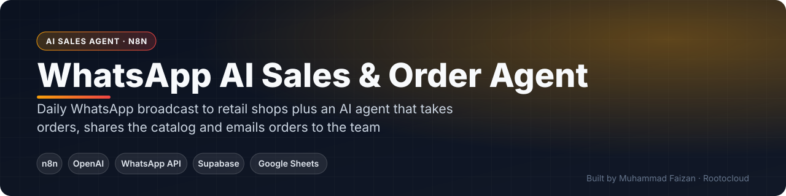
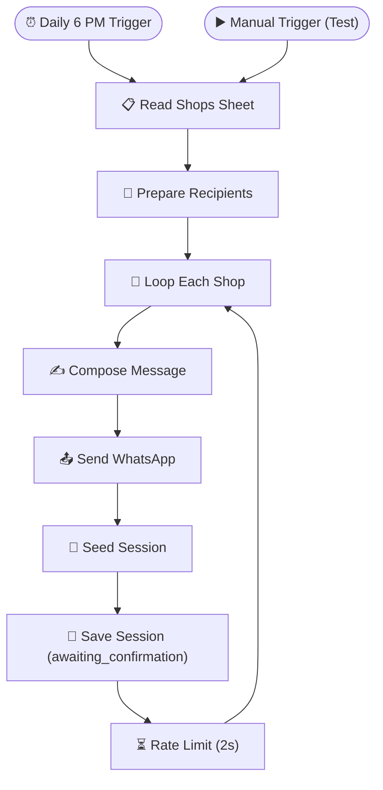
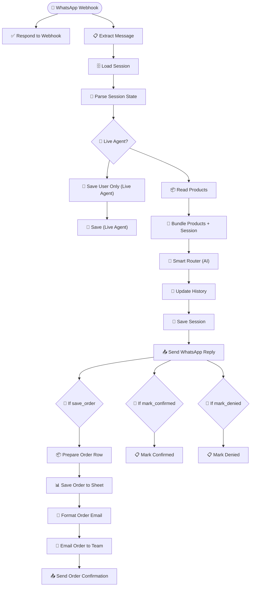

 

    

 

**[Get this built for your business](https://www.fiverr.com/faizan_develope) · [Rootocloud](https://rootocloud.com) · [More projects](https://github.com/MuhammadFaizan73)**

---

## 📌 Overview

Two connected workflows that digitise a distributor's field-sales process. Every evening the broadcaster messages each shop about the next salesman visit; the reply handler then runs an AI sales conversation on WhatsApp — reading the product list, answering questions, taking orders, sending the PDF catalog and confirming or cancelling orders.

## ✨ What It Does

- Scheduled broadcast to every shop from a Google Sheet, rate-limited
- Session state seeded per shop (awaiting confirmation)
- AI smart router reads the live product list and decides the next action
- Orders saved to Google Sheets and emailed to the sales team
- PDF catalog sent on request
- Visit confirmation / denial tracking and live-agent mode

## 📈 Business Impact

Shops can confirm visits and place orders without a phone call, and the sales team receives clean, structured orders every day.

## 🔀 How It Works

The diagram below is generated directly from the production n8n workflow.

### Workflow: Salesman Visit Broadcaster — 10 nodes

### Workflow: Salesman Reply Handler — 24 nodes

<!-- SCREENSHOTS -->
<!-- /SCREENSHOTS -->

## 🔒 About the Workflow File

This automation was built for a client, so the n8n workflow JSON (with prompts, credentials and business logic) is kept private.
**I can build a version tailored to your business** — [contact me on Fiverr](https://www.fiverr.com/faizan_develope) or [email](mailto:faizan.developer9200@gmail.com).

## 👨‍💻 Author

**Muhammad Faizan** — Founder, [Rootocloud](https://rootocloud.com) · n8n & AI Automation Specialist (8+ years)

© Muhammad Faizan. All rights reserved.

